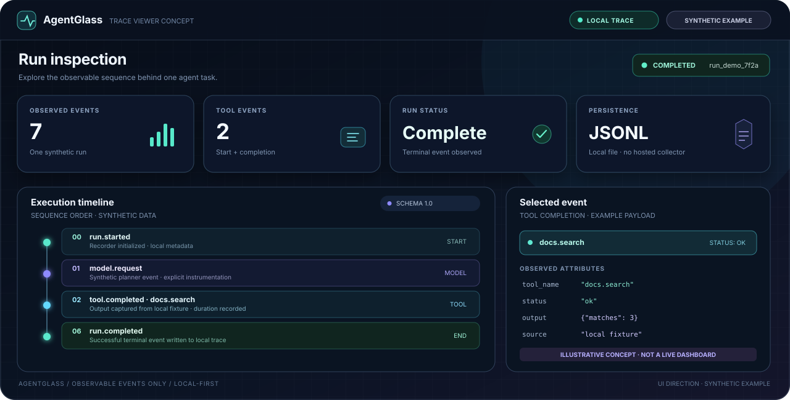
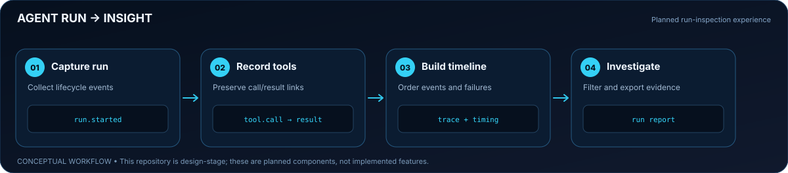
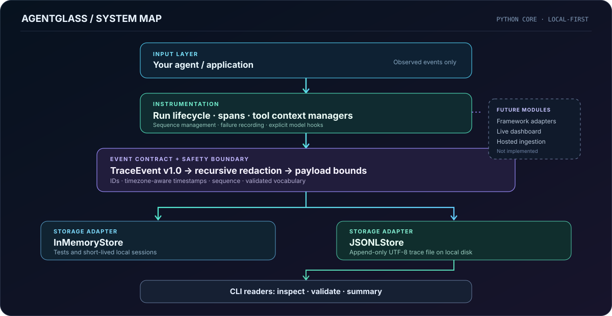

<div align="center">



<p><strong>Trace the work. Find the failure. Keep the evidence.</strong></p>
<p>A local-first Python toolkit for recording AI-agent runs, tool calls, spans, and failures as structured events.</p>
<p><sub>Built and maintained by <a href="https://verityagent.lovable.app"><strong>VerityAgent</strong></a> · AI agents, automation, and developer tools</sub></p>

<p>
  <a href="https://github.com/muhammadsaeed-ai/AgentGlass/actions/workflows/ci.yml"></a>
  
  
  
</p>

<p>
  <a href="#-quick-start">Quick start</a> ·
  <a href="#-what-you-can-do-today">Capabilities</a> ·
  <a href="#-how-the-trace-flows">Trace flow</a> ·
  <a href="docs/architecture.md">Architecture</a> ·
  <a href="docs/privacy-security.md">Security</a>
</p>

</div>

---

<table>
<tr>
<td width="50%" valign="top">

<h3>◈ Built for debugging</h3>
<p>Follow the observable sequence across a run: start, operation, tool result, and terminal status.</p>

</td>
<td width="50%" valign="top">

<h3>◈ Local by default</h3>
<p>Write traces to memory or local JSONL. The AgentGlass library makes no network calls.</p>

</td>
</tr>
<tr>
<td width="50%" valign="top">

<h3>◈ Evidence, not guesses</h3>
<p>Durations come from recorded operations. Usage and cost are not invented when provider data is absent.</p>

</td>
<td width="50%" valign="top">

<h3>◈ Deliberate data handling</h3>
<p>Redact common secrets before storage, bound oversized values, and validate malformed event records.</p>

</td>
</tr>
</table>

## A glimpse of the trace experience

<p align="center">
  
</p>

<p align="center"><sub>Illustrative UI concept using synthetic events — not a shipped web dashboard. The implemented interface today is the Python SDK and command-line inspector.</sub></p>

## ▶ Watch the 56-second explainer

See the complete story as a looping motion graphic: why agent traces matter, how events are recorded and normalized, how spans are timed, where redaction happens, how local JSONL storage and CLI inspection work, and which capabilities are implemented versus planned.

<p align="center">
  
</p>

<p align="center">
  <a href="docs/agentglass-explainer.html"><strong>Open the interactive explainer</strong></a> · Play / pause · Restart · Chapter navigation · Progress control · Full scene notes
</p>

The self-contained player uses HTML, CSS, and JavaScript only—no external libraries, remote assets, or API calls. The example traces and values are synthetic. The animation does not imply that the dashboard or roadmap features are already shipped.

### Play the interactive version locally

From the repository root, start a local static server:

```bash
python -m http.server 8000
```

Then open [http://localhost:8000/docs/agentglass-explainer.html](http://localhost:8000/docs/agentglass-explainer.html) in your browser. The player is designed for a 56-second walkthrough and can be controlled or stepped through chapter by chapter.

## What you can do today

| Capability | Current implementation |
|---|---|
| Run lifecycle | Start, complete, fail, or cancel a recorded run |
| Spans and tools | Record start/end events, duration, output metadata, and errors |
| Event contract | Validate typed event kinds, timezone-aware timestamps, IDs, and schema version |
| Redaction | Mask common credential keys, recognizable token patterns, and emails before persistence |
| Local storage | In-memory store and append-only JSONL file store |
| CLI | Create a synthetic trace, inspect events, validate files, and summarize runs |
| Quality checks | Unit tests and GitHub Actions on Python 3.11 and 3.12 |

**Honest project status:** AgentGlass is an early-stage, usable tracing core. A live browser dashboard, automatic integrations for specific agent frameworks, hosted ingestion, and token-cost analytics are planned—not shipped.

## How the trace flows

<p align="center">
  
</p>

The application runs its own model requests and tools. AgentGlass records the observations your code explicitly passes to it; it does not execute tools, automatically instrument every provider, or expose hidden model reasoning.

## Quick start

**Requirements:** Python 3.11 or later. No runtime dependencies.

### 1. Install

```bash
git clone https://github.com/muhammadsaeed-ai/AgentGlass.git
cd AgentGlass
python -m pip install .
```

### 2. Generate a local example

```bash
agentglass demo --output traces/demo.jsonl
```

This creates a **synthetic offline trace**. It does not call an LLM, contact an agent framework, or send trace data to a service.

### 3. Inspect it

```bash
agentglass inspect traces/demo.jsonl
agentglass validate traces/demo.jsonl
agentglass summary traces/demo.jsonl
```

## Instrument a workflow

Wrap the operation you want to observe. Your application still executes the tool and supplies its real result.

```python
from agentglass import AgentGlass, EventType, JSONLStore

client = AgentGlass(
    store=JSONLStore("traces/assistant.jsonl"),
    service_name="knowledge-assistant",
)

with client.start_run(attributes={"workflow": "knowledge_lookup"}) as run:
    run.record(
        EventType.MODEL_REQUEST,
        name="planner",
        attributes={"provider": "your-provider", "model": "your-model"},
    )

    with run.tool("docs.search", input={"query": "agent tracing"}) as tool:
        result = {"matches": 3}  # Replace with your real tool call.
        tool.set_output(result)

    run.record(EventType.MODEL_RESPONSE, name="planner")
```

<details>
<summary><strong>See the event sequence and CLI commands</strong></summary>

A typical instrumented run records a sequence resembling:

```text
run.started
custom            run.metadata        # only when run attributes are supplied
model.request     planner
tool.started      docs.search
tool.completed   docs.search         # duration + parent event ID
model.response    planner
run.completed
```

The CLI supports:

| Command | Purpose |
|---|---|
| <code>agentglass demo --output PATH</code> | Write synthetic events |
| <code>agentglass inspect PATH</code> | Print the event timeline |
| <code>agentglass inspect PATH --run-id ID</code> | Filter to one run |
| <code>agentglass validate PATH</code> | Validate every non-empty JSONL record |
| <code>agentglass summary PATH</code> | Group events by run and event kind |

</details>

## Architecture

<p align="center">
  
</p>

The core is intentionally small:

1. **Record** observations through run, span, and tool context managers.
2. **Normalize** them into a versioned <code>TraceEvent</code> shape.
3. **Redact** common sensitive values and bound payload size before the store receives an event.
4. **Persist** structured JSONL locally or keep events in memory.
5. **Inspect** the same schema using CLI readers.

## Privacy and reliability

- Redaction is a **best-effort safety net**, not a complete data-loss-prevention system.
- Local trace files may still contain confidential business context. Review exports before sharing them.
- Use synthetic fixtures in issues and pull requests; never commit credentials or customer traces.
- Malformed JSONL records are reported with a path and line number rather than silently ignored.
- The library does not send telemetry or upload traces.

Read the [privacy and security model](docs/privacy-security.md) and [security policy](SECURITY.md).

## Development

```bash
python -m unittest discover -s tests -v
python -m agentglass demo --output traces/demo.jsonl
python -m agentglass validate traces/demo.jsonl
```

The test suite covers event validation, redaction, run/span/tool lifecycle behavior, JSONL persistence, malformed records, and CLI operations.

<details>
<summary><strong>Repository layout</strong></summary>

```text
AgentGlass/
├── agentglass/
│   ├── models.py          # Versioned event contract
│   ├── recorder.py        # Run, span, and tool instrumentation
│   ├── redaction.py       # Secret masking and payload bounds
│   ├── storage.py         # Memory and JSONL stores
│   ├── cli.py             # Demo, inspect, validate, summary
│   └── __main__.py        # python -m agentglass
├── assets/readme/         # Hero and animated architecture visuals
├── docs/                  # Architecture, schema, privacy
├── tests/
└── .github/workflows/     # Python 3.11 / 3.12 CI
```

</details>

## Roadmap

- [x] Versioned event model and local recorder
- [x] Span/tool timing and failure events
- [x] Local JSONL persistence and CLI inspection
- [x] Best-effort redaction and payload bounds
- [x] Unit tests and CI for Python 3.11 / 3.12
- [ ] Improved trace filtering and structured export
- [ ] One framework adapter with real integration tests
- [ ] Interactive local dashboard backed by real trace files
- [ ] Trusted usage metadata for measured token and cost attribution
- [ ] Separate threat-model review before any hosted or multi-user service

## Contributing

Bug reports, schema feedback, synthetic fixtures, and focused pull requests are welcome. See [CONTRIBUTING.md](CONTRIBUTING.md). Roadmap items must remain clearly distinguished from implemented capabilities.

## Topics

<code>ai-agent-observability</code> · <code>llm-observability</code> · <code>agent-tracing</code> · <code>tool-call-tracing</code> · <code>ai-agents</code> · <code>python</code> · <code>developer-tools</code> · <code>llm-monitoring</code>

<div align="center">

---

<strong>AgentGlass</strong><br/>
<sub>Observe what happened. Trace what failed. Keep control of your data.</sub>

</div>
